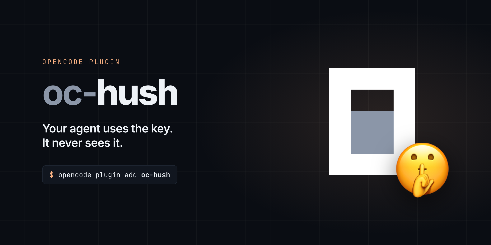

# oc-hush



Credentials your agent can use without reading them.

When a command needs an API key or token, Hush asks you for it in a private prompt instead of the chat. The agent gets to use it in its command, but the key itself never reaches the model or the conversation.

**WIP.** Works in the OpenCode TUI and desktop app. Requires OpenCode 2.2.6 or newer.

## Install

```sh
opencode plugin add oc-hush
```

Restart OpenCode after installing. In the desktop app, Hush only loads when installed this way (globally), not from a project’s config.

## Usage

Just work as usual. When a command needs a credential, the agent asks through Hush, or you can ask it to:

```
Use Hush to get my GitHub token, then run gh repo list with it.
```

A **Temporary Credential** dialog opens and names what the agent needs, such as "GitHub token". Paste or type it there, never in the chat.

**In the TUI**

- The credential shows as dots and stays out of the prompt and its history.
- **Tab** shows what you typed; press it again to hide it.
- **Enter** approves, **Esc** denies.

**In the desktop app**

- The credential goes into a password field.
- The **eye button** shows what you typed; click it again to hide it.
- **Approve** sends it, **Deny** refuses. Esc just closes the dialog: the request waits in a lock pill above the composer, and clicking it reopens the dialog.

If the agent asks in a session you are not looking at, a toast lets you jump to it, and you get a system notification while OpenCode is in the background. Requests from subagents show up in the session you are watching.

Run `/hush-forget` to forget this session’s credentials right away and cancel any waiting requests.

## Options

```jsonc
{ "plugins": [{ "package": "oc-hush", "options": { "ttlMinutes": 15 } }] }
```

- `ttlMinutes`: how long Hush keeps a credential after you approve it. Default `15`, maximum `1440`. `0` forgets it after the first command that uses it.

## How it keeps your credential safe

- **You never paste it into chat.** It goes into Hush’s own dialog, which starts hidden every time.
- **The agent only gets a file path.** Hush stores the credential in a private file only you can read, and the agent’s command reads it from there.
- **Output is scrubbed.** If a command prints the credential, even encoded, Hush replaces it with `[redacted by Hush]` before the model sees it or the session is saved.
- **It doesn’t stick around.** Credentials are deleted after 15 minutes (or your `ttlMinutes`), on `/hush-forget`, and when OpenCode exits. Unanswered requests expire after five minutes.

> [!NOTE]
> Commands run with your permissions, so they can read the file. Redaction catches the credential whole or encoded, but a command written to print it in pieces (such as `cut -c1-6 <file>`) would get past it. That takes a command you approve, and OpenCode’s permission prompt shows it in full first. Approve commands that use the file as you would any command that handles a secret.

Hush protects your credential from the agent and the conversation. It does not protect against malware, other plugins or programs running on your machine.

## Contributing

See [DEVELOPMENT.md](DEVELOPMENT.md).
